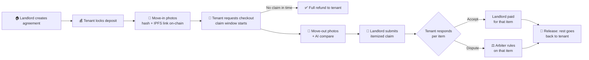

<div align="center">

# 🏠 Walls Don't Lie

### Proof on every wall. Deposit back in your hands.

*Deposits held in a smart contract. Settled by photo proof, not phone calls.*

<br/>

[](https://walls-dont-lie.vercel.app)


</div>

---

## 💔 The problem

*"It was already like that."* Almost every tenant has said it. Almost none can prove it.

Deposits get held for weeks, photos get lost, and going to court costs more than the deposit itself. So the landlord's word wins, not because it's true, but because it's the only one on record.

## 💡 What is this?

**Walls Don't Lie** is a decentralized rental deposit escrow. The deposit is locked in a smart contract, photo hashes are recorded on-chain, and AI shows what changed between move-in and move-out. Money moves only by the contract's rules.

> **AI advises. The contract enforces. The arbiter settles disputes.**

> 🧪 Runs on the **Sepolia testnet** with free test ETH. No real money is involved.

---

## 🧭 How it works



1. **Landlord creates the agreement:** tenant wallet, deposit and claim window.
2. **Tenant locks the exact deposit** in the contract.
3. **Move-in photos:** each photo's hash and IPFS link are recorded on-chain with a block timestamp, so they can't be edited later.
4. **Tenant requests checkout,** which starts the claim window. Move-out photos can be added by the tenant or the landlord.
5. **AI compares** move-in and move-out photos and shows the differences. It never moves money.
6. **Landlord submits an itemized claim** (for example "wall scratch") inside the window. The total can't exceed the deposit.
7. **Tenant accepts or disputes each item.** Disputed items go to the arbiter, who sets the amount, never more than claimed.
8. **Release:** if no claim is made in time, the full deposit goes back to the tenant. Anyone can trigger the payout, so the landlord can't block it. Otherwise the agreed amounts go to the landlord and the rest to the tenant.

If the tenant ignores a claim, the items go to the arbiter. The landlord is never auto-paid.

---

## 👥 Roles

| Role | What they can do |
|---|---|
| **Landlord** | Creates the agreement, adds evidence, submits an itemized claim inside the claim window |
| **Tenant** | Locks the deposit, adds evidence, requests checkout, accepts or disputes each claimed item |
| **Arbiter** | Appears only in a dispute. Views all evidence and rules on disputed items. Cannot create agreements or hold funds, and can't be a party in the same agreement |
| **Anyone** | Can trigger the payout once the rules allow it |

---

## 🎯 Example (sample data shown in the app)

| | |
|---|---|
| **Location** | Living Room, East Wall |
| **Deposit** | `$2,400.00` |
| **Landlord's claim** | `$1,200` for repainting, citing scuff marks |
| **AI diff** | Move-in photos already showed paint fading, so the AI flags it as **normal wear** |
| **Tenant** | Disputes the item |
| **Arbiter** | Reviews the evidence and awards `$0` |
| **Outcome** | Full `$2,400` returns to the tenant. 0 phone calls, 0 court fees |

---

## ✨ Core features

| | Feature | What it does |
|---|---|---|
| 🔒 | **Smart contract escrow** | The deposit is locked on-chain. Funds move only by contract rules |
| 🧾 | **Tamper-evident proof** | Photo hashes and IPFS links are anchored on the Sepolia contract with timestamps |
| 🤖 | **AI photo comparison** | Google Gemini shows what changed and separates real damage from normal wear |
| 🧩 | **Itemized claims** | Each claimed item is accepted or disputed separately |
| ⚖️ | **Arbiter for disputes** | A neutral third party rules only on disputed items |
| ⏱️ | **Claim window** | 1 minute to 90 days. No claim in time means a full refund |
| 🛡️ | **Safe payouts** | Reentrancy protection, and a failed payout is saved for withdrawal so nobody's money gets locked |
| 🦊 | **MetaMask login** | The connected wallet is your identity |

---

## 📸 Screenshots

<table>
  <tr>
    <td width="50%" align="center">
      
      <br/><sub><b>AI diff + proof chain</b></sub>
    </td>
    <td width="50%" align="center">
      
      <br/><sub><b>Create an on-chain agreement</b></sub>
    </td>
  </tr>
  <tr>
    <td colspan="2" align="center">
      
      <br/><sub><b>Agreements dashboard</b> on Sepolia via MetaMask</sub>
    </td>
  </tr>
</table>

---

## 🛠️ Tech stack

| Layer | Technologies |
|---|---|
| **Smart contract** | Solidity · Foundry · OpenZeppelin · Sepolia testnet |
| **Frontend** | React · TypeScript · Vite · Tailwind CSS · ethers.js · Three.js · Framer Motion |
| **Backend** | Node.js · Express |
| **AI** | Google Gemini (`@google/genai`) |
| **Evidence storage** | IPFS (link recorded on-chain) |

---

## 📜 Smart contract

- Source: [`contracts/src/RentalEscrow.sol`](contracts/src/RentalEscrow.sol)
- Tests: [`contracts/test/RentalEscrow.t.sol`](contracts/test/RentalEscrow.t.sol)
- ABI: [`docs/RentalEscrow.abi.json`](docs/RentalEscrow.abi.json)
- **Sepolia address:** `YOUR_CONTRACT_ADDRESS`
- Etherscan: https://sepolia.etherscan.io/address/YOUR_CONTRACT_ADDRESS

Run the tests:

```bash
cd contracts
forge test
```

---

## 🚀 Run the app locally

```bash
git clone https://github.com/sharanyashetty013-droid/Solidity-gang-.git
cd Solidity-gang-
npm install
cp .env.example .env    # add your own keys
npm run dev
```

You need Node.js, MetaMask on Sepolia with test ETH, and a [Gemini API key](https://aistudio.google.com/apikey).

---

## 📁 Project structure

```
Solidity-gang-/
├── contracts/
│   ├── src/RentalEscrow.sol
│   └── test/RentalEscrow.t.sol
├── docs/              # ABI + screenshots
├── public/
├── src/               # React + TypeScript app
├── .env.example
└── package.json
```

---

## ⚠️ Known limits (hackathon scope)

- The arbiter is set by the contract deployer. Production would use a multisig or a panel.
- There is no arbiter timeout yet.
- Only the tenant can request checkout. Production would let the landlord do it after the lease end date.
- ETH only, on testnet.

## 🗺️ Roadmap

- [x] Escrow contract with itemized claims and arbiter
- [x] Evidence timeline and AI diff UI
- [ ] Arbiter timeout and multisig arbiter panel
- [ ] ERC-20 / stablecoin deposits
- [ ] Landlord-triggered checkout
- [ ] Mobile-first capture flow
- [ ] Contract audit

---

<div align="center">

### Built by the **Solidity Gang** 💗
*Because walls don't lie.*

</div>
