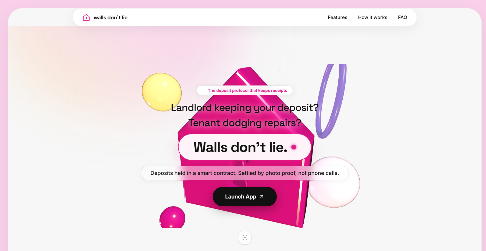
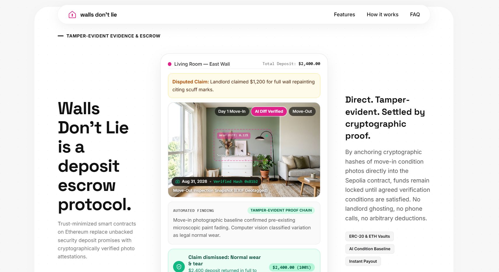
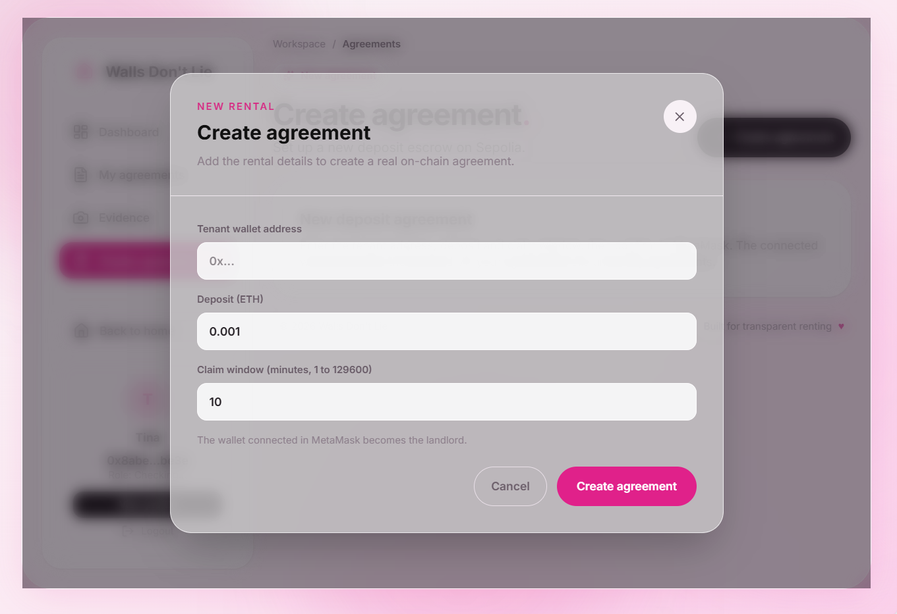
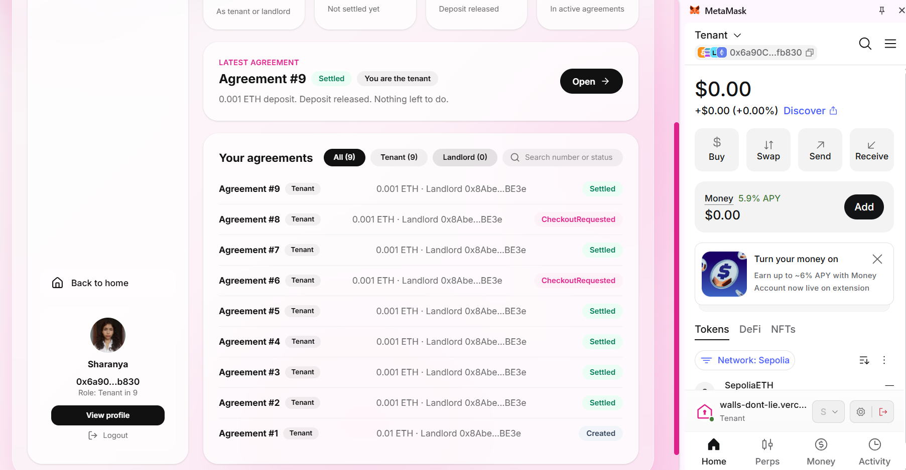
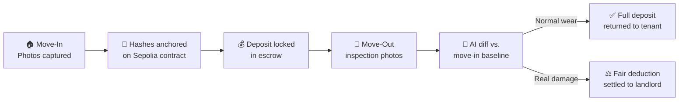

<div align="center">

# 🏠 Walls Don't Lie

### Proof on every wall. Deposit back in your hands.

*Landlord keeping your deposit? Tenant dodging repairs?*
*Deposits held in a smart contract. Settled by photo proof, not phone calls.*

<br/>

[](https://walls-dont-lie.vercel.app)


<br/>



</div>

---

## ✨ What is this?

**Walls Don't Lie** is a decentralized **rental deposit escrow protocol**.

Security deposits are one of the most disputed parts of renting. Claims get made, photos get lost, and the tenant ends up chasing the landlord over phone calls. Walls Don't Lie replaces all of that with **cryptographic proof**:

> 📸 Photos are taken at move-in → 🔐 their hashes are anchored on-chain → 🤖 AI compares them with move-out photos → 💸 the contract settles the deposit automatically.

No he-said-she-said. No court fees. Just evidence.

---

## 🎯 See it in action

A real-world example from the app:

| | |
|---|---|
| 🏢 **Location** | Living Room, East Wall |
| 💰 **Total deposit** | `$2,400.00` |
| ⚠️ **Landlord's claim** | `$1,200` for full wall repainting, citing scuff marks |
| 🤖 **AI diff finding** | Move-in baseline already showed pre-existing microscopic paint fading. Classified as **normal wear**. |
| ✅ **Outcome** | Claim dismissed. **$2,400 returned to the tenant in full, automatically.** |
| 📞 **Phone calls / court fees** | `0` / `0` |

---

## 🔥 Core Capabilities

| | Feature | What it does |
|---|---|---|
| 🔒 | **Smart Contract Escrow** | Deposits are locked and managed transparently on-chain. Nobody can touch the funds until the outcome is agreed or proven. |
| 🤖 | **Automated Evidence Checks** | AI-driven photo verification compares check-in and check-out conditions and tells real damage apart from normal wear and tear. |
| 🧾 | **Tamper-Evident Proof Chain** | Cryptographic hashes of move-in photos are anchored on the Sepolia contract, so evidence can't be quietly altered later. |
| 📍 | **Geotagged Snapshots** | Inspection photos carry EXIF and location data to back up when and where they were taken. |
| 🦊 | **MetaMask Login** | Connect your wallet to create and manage agreements. The connected wallet becomes the landlord, and the tenant is set by address. |
| ⏱️ | **Configurable Claim Window** | The landlord picks how long they have to raise a claim (1 to 129,600 minutes) before the deposit is released. |
| 🪙 | **ERC-20 & ETH Vaults** | Deposits can be held in ETH or ERC-20 tokens, with instant payout on settlement. |
| ⚡ | **Decentralized Trust** | No intermediary bias. Deposits are returned based strictly on verified records. |

---

## 📸 Screenshots

<table>
  <tr>
    <td width="50%" align="center">
      
      <br/><sub><b>AI diff + tamper-evident proof chain</b><br/>A $1,200 repainting claim is dismissed as normal wear.</sub>
    </td>
    <td width="50%" align="center">
      
      <br/><sub><b>Create an on-chain agreement</b><br/>Set the tenant, deposit and claim window.</sub>
    </td>
  </tr>
  <tr>
    <td colspan="2" align="center">
      
      <br/><sub><b>Agreements dashboard</b><br/>Track every deposit from <code>Created</code> to <code>Settled</code>, connected through MetaMask on Sepolia.</sub>
    </td>
  </tr>
</table>

---

## 🧭 How it works



1. **Create** an agreement: tenant wallet, deposit amount and claim window.
2. **Document** the place on Day 1 with timestamped photos.
3. **Anchor** the photo hashes on-chain and lock the deposit.
4. **Compare** move-out photos against the baseline using AI.
5. **Settle** automatically (`Created` → `CheckoutRequested` → `Settled`), on evidence rather than opinion.

---

## 🛠️ Tech Stack

| Layer | Technologies |
|---|---|
| **Frontend** | React · TypeScript · Vite · Tailwind CSS · Three.js · Framer Motion |
| **Backend** | Node.js · Express |
| **AI Engine** | Google Gen AI SDK (`@google/genai`) |
| **Blockchain** | Solidity · Ethereum (Sepolia testnet) |

---

## 🚀 Getting Started

### Prerequisites

- [Node.js](https://nodejs.org/) installed on your machine
- A [Gemini API key](https://aistudio.google.com/apikey) for the AI evidence checks

### Installation

**1. Clone the repository**

```bash
git clone https://github.com/sharanyashetty013-droid/Solidity-gang-.git
cd Solidity-gang-
```

**2. Switch to the frontend branch**

```bash
git checkout feature/frontend-components
```

**3. Install dependencies**

```bash
npm install
```

**4. Set up environment variables**

```bash
cp .env.example .env
```

Then open `.env` and fill in your keys (see `.env.example` for the exact variable names).

**5. Run the app**

```bash
npm run dev
```

Open the local URL shown in your terminal and you're in. 🎉

---

## 📁 Project Structure

```
Solidity-gang-/
├── docs/screenshots # README images
├── public/          # Static assets
├── src/             # React + TypeScript source
├── .env.example     # Environment variable template
├── index.html       # App entry point
├── vite.config.ts   # Vite configuration
└── package.json
```

---

## 🗺️ Roadmap

- [x] Landing page with 3D hero
- [x] Evidence timeline and AI diff UI
- [ ] Mainnet-ready escrow contract audit
- [ ] Multi-room, multi-photo inspections
- [ ] Mobile-first capture flow
- [ ] Dispute appeals with human arbitrators

---

## 🤝 Contributing

Contributions, issues and feature ideas are welcome! Fork the repo, create your branch, and open a pull request.

---

<div align="center">

### Built by the **Solidity Gang** 💗

*Because walls don't lie.*

</div>
